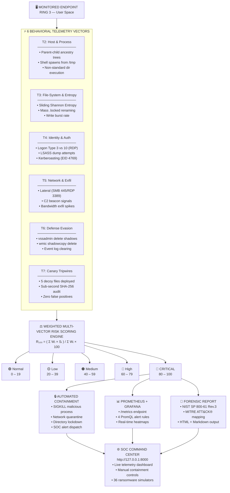
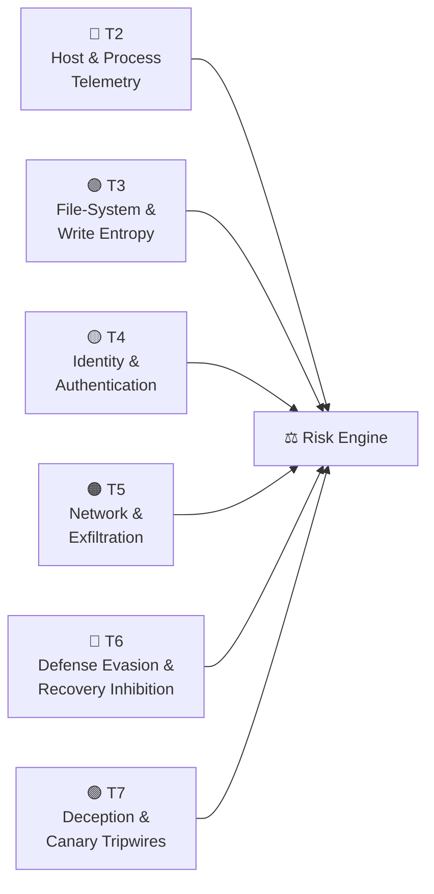
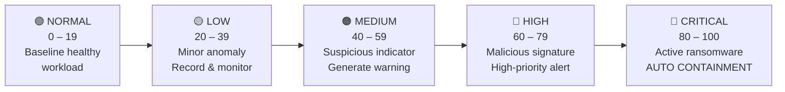
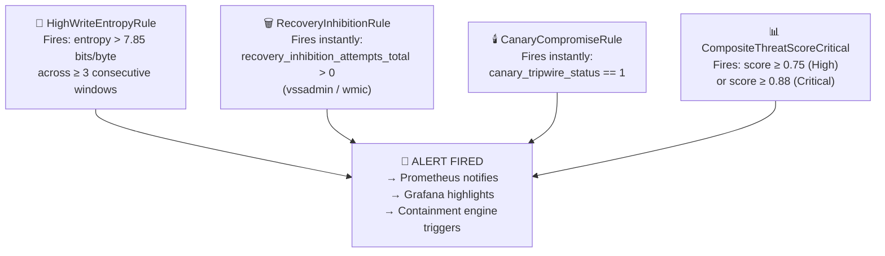
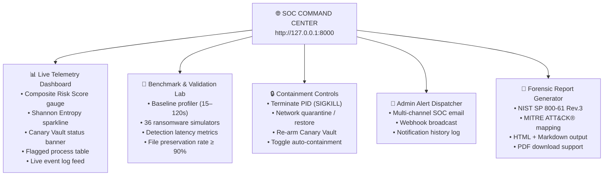
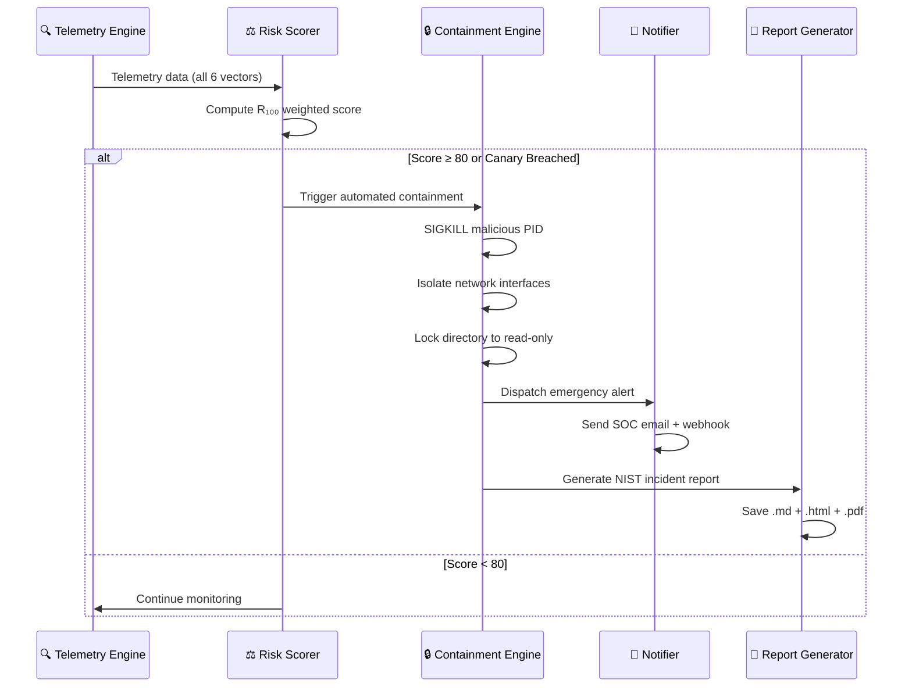

<div align="center">

# 🛡️ Ransomware Behaviour Analysis & Early Warning Framework

### A Multi-Vector Behavioral Telemetry & Automated Containment System


**Academic Context:** Chandigarh University &mdash; BE-CSE (Information Security) &mdash; Production Deployment

</div>

---

## 📋 Table of Contents

- [Executive Summary](#1-executive-summary--framework-architecture)
- [System Architecture](#system-architecture-flow)
- [6 Telemetry Submodules](#2-the-6-modular-telemetry-submodules)
- [Risk-Scoring Model](#3-risk-scoring-model-multi-vector-specification)
- [Prometheus & Grafana](#4-prometheus--grafana-configuration)
- [SOC Command Center](#5-centralized-soc-command-center--incident-response-portal)
- [How to Run](#6-how-to-run-and-verify)

---

## 1. Executive Summary & Framework Architecture

Modern cryptographic ransomware (*LockBit 3.0*, *BlackCat/ALPHV*, *Royal*, *Conti*) exhibits severe temporal compression — median breakout times below **29 minutes**, with encryption routines capable of locking thousands of files in seconds. Reactive signature-based defenses (hashes, static YARA rules) are trivially defeated by polymorphic recompilation.

This framework implements a **real-time, behavior-based early warning and automated containment system**:

| # | Component | Description |
|---|-----------|-------------|
| 1 | 🔍 **6 Behavioral Telemetry Collectors** | Continuously extracting runtime invariants across all attack vectors |
| 2 | ⚖️ **Weighted Risk-Scoring Engine** | Computing composite threat scores (0.0 – 1.0 normalized, 0 – 100 displayed) |
| 3 | 📊 **Prometheus & Grafana Stack** | Real-time observability with PromQL alert rule evaluation |
| 4 | 🔒 **Automated Containment Engine** | Sub-second SIGKILL, directory write revocation, network isolation |
| 5 | 📢 **Admin Notification Dispatcher** | Multi-channel SOC alerting (email, webhook, SMS) |
| 6 | 📄 **Forensic Report Generator** | NIST SP 800-61 Rev. 3 & MITRE ATT&CK® compliant reports |
| 7 | 🧪 **Controlled Simulation Lab** | 36 real ransomware family emulators for safe evaluation |

---

## System Architecture Flow


                              MONITORED ENDPOINT
  +---------------------------------------------------------------------------------+
  |                             RING 3 (User Space)                                 |
  |                                                                                 |
  |  [T2: Host & Process]      [T3: Entropy & FS]        [T4: Identity & Auth]      |
  |  - Ancestry trees          - Sliding Shannon entropy  - Logon Type 3 vs 10      |
  |  - Shell spawns            - Mass .locked renaming    - LSASS dump attempts     |
  |  - Temp dir execution      - Write burst rate         - Kerberoasting (4769)    |
  |                                                                                 |
  |  [T5: Network & Exfil]     [T6: Defense Evasion]     [T7: Deception Tripwires]  |
  |  - Lateral (445/135/3389)  - vssadmin delete shadows - 5 Decoy canary files     |
  |  - C2 beacon signals       - wmic shadowcopy delete  - Sub-second SHA-256 audit |
  |  - Bandwidth spikes        - Event log clearing      - Zero false positives     |
  +---------------------------------------------------------------------------------+
                                      |
                                      v
  +---------------------------------------------------------------------------------+
  |                  WEIGHTED MULTI-VECTOR RISK SCORING ENGINE                      |
  |                  R_100 = ( sum(Wi * Si) / sum(Wi) ) * 100                       |
  |   Normal (0-19) | Low (20-39) | Medium (40-59) | High (60-79) | Critical (80-100)|
  +---------------------------------------------------------------------------------+
                         /                          \
                        v                            v
  +-------------------------------+    +--------------------------------------------+
  |    PROMETHEUS TIME-SERIES     |    |   CENTRALIZED SOC COMMAND CENTER (Port 8000)|
  |    & GRAFANA OBSERVABILITY    |    |   - Live Telemetry Dashboard & Entropy Radar|
  |  - Prometheus Scrape (/metrics|    |   - Automated Process Kill (ZwTerminateProc)|
  |  - 4 Alert Rules              |    |   - Network Isolation & Directory Lockdown  |
  |  - Grafana 10 Dashboard JSON  |    |   - Multi-channel Admin Notifications       |
  |  - Real-Time Heatmaps         |    |   - NIST SP 800-61 Incident Reports (MD/HTML|
  +-------------------------------+    |   - Controlled Attack Simulation Suite     |
                                       +--------------------------------------------+
```

---

## 2. The 6 Modular Telemetry Submodules

Each submodule lives in `telemetry/` and exposes structured Prometheus metrics:



| ID | Telemetry Submodule | Source File | Key Detection Invariants | Primary Prometheus Metrics |
|:--:|:--------------------|:------------|:-------------------------|:--------------------------|
| **T2** | **Host & Process Telemetry** | `telemetry/host_process_telemetry.py` | Parent-child ancestry trees, non-standard directory executions (`/tmp`, `\AppData\Local\Temp\`), Win32/POSIX shell spawns | `process_threat_score`<br>`suspicious_process_spawns_total`<br>`process_cpu_percent` |
| **T3** | **File-System & Write Entropy** | `telemetry/filesystem_entropy_telemetry.py` | Sliding-window Shannon Entropy H(X), consecutive high entropy writes (>7.85 bits/byte), mass renaming, ransomware extensions (`.locked`, `.crypto`, `.enc`) | `process_write_entropy_bits`<br>`file_renames_per_sec`<br>`high_entropy_files_total` |
| **T4** | **Identity & Authentication** | `telemetry/identity_auth_telemetry.py` | Logon Type 3 (Network) vs Type 10 (RDP), Kerberoasting (Event ID 4769), unauthorized handle access to `lsass.exe` | `auth_failed_logins_total`<br>`auth_suspicious_logon_types_total`<br>`credential_dump_attempts_total` |
| **T5** | **Network & Exfiltration** | `telemetry/network_exfil_telemetry.py` | Process-level socket monitoring (SMB 445, RPC 135, RDP 3389, SSH 22), outbound C2 beaconing, bandwidth spikes | `network_outbound_bytes_total`<br>`network_c2_beacons_total`<br>`network_lateral_scan_attempts_total` |
| **T6** | **Defense Evasion** | `telemetry/defense_evasion_telemetry.py` | Shadow copy destruction (`vssadmin delete shadows`, `wmic shadowcopy delete`), recovery suppression (`bcdedit`), event log clearing (`wevtutil cl`) | `recovery_inhibition_attempts_total`<br>`defense_evasion_commands_total`<br>`tampering_events_total` |
| **T7** | **Deception & Canary Tripwires** | `telemetry/deception_tripwire_telemetry.py` | 5 strategically deployed decoy assets (`.xlsx`, `.docx`, `.sql`, `.env`, `.pdf`) with continuous sub-second SHA-256 integrity audits; **0.02s – 1.3s** detection, zero false positives | `canary_tripwire_status`<br>`canary_compromised_files_total`<br>`canary_check_latency_ms` |

---

## 3. Risk-Scoring Model (Multi-Vector Specification)

The Composite Risk Engine calculates a weighted normalized risk score:

```
R₁₀₀ = ( Σ Wᵢ × Sᵢ ) / Σ Wᵢ × 100
```

Where `Wᵢ` is indicator weight and `Sᵢ ∈ [0.0, 1.0]` is normalized indicator severity.

### Weight Distribution

```
Canary Decoy Breached       ████████████████████████████████████  W = 35.0 ★ DETERMINISTIC
High Write Entropy (>7.85)  █████████████████████████            W = 25.0
Recovery Inhibition Cmd     ████████████████████                 W = 20.0
Mass File Renaming          ███████████████                      W = 15.0
Suspicious Process Ancestry ██████████                           W = 10.0
Network C2 / Lateral Move   ██████████                           W = 10.0
Identity / Credential Dump  ██████████                           W = 10.0
```

> ⚠️ **Canary breach alone immediately elevates composite score to ≥ 92.5 (Critical)**

### Risk Tier Response Matrix



| Score Range | Level | Color | Automated Action |
|:-----------:|:-----:|:-----:|:-----------------|
| 0 – 19 | Normal | 🟢 | Continue baseline monitoring |
| 20 – 39 | Low | 🟡 | Record event, monitor for recurrence |
| 40 – 59 | Medium | 🟠 | Generate warning, review telemetry |
| 60 – 79 | High | 🔴 | Issue high-priority SOC alert |
| **80 – 100** | **Critical** | 🚨 | **Immediate: SIGKILL + Network Isolate + Report** |

---

## 4. Prometheus & Grafana Configuration

### Prometheus Scrape Configuration (`config/prometheus.yml`)

Scrapes all telemetry metrics at **2-second** low-latency intervals:

```yaml
global:
  scrape_interval: 2s
  evaluation_interval: 2s

scrape_configs:
  - job_name: "ransomware_early_detection_unified"
    metrics_path: "/metrics"
    static_configs:
      - targets: ["127.0.0.1:8000"]
```

### Alert Rules (`config/alert.rules.yml`)



### Grafana Unified Dashboard (`config/grafana_dashboard.json`)

Pre-configured panels:
- 🎯 **Threat Score Gauge** — Live composite risk score dial (0–100)
- 🌡️ **Entropy Heatmap** — Write entropy over time (threshold line at 7.85)
- 🕯️ **Canary Tripwire Banner** — Single-stat INTACT / BREACHED status
- 🏆 **Process Threat Rankings** — Top flagged PIDs with scores
- 🌐 **Network Flow & C2 Beacons** — Lateral movement port graph

---

## 5. Centralized SOC Command Center & Incident Response Portal

> 🌐 **Access at:** [`http://127.0.0.1:8000`](http://127.0.0.1:8000)



### Automated Containment Sequence



### Supported Ransomware Simulation Families (36 Total)

| Generation | Families |
|:----------:|:---------|
| 🕰️ Classic | WannaCry, NotPetya, Bad Rabbit, SamSam, GandCrab |
| 🏭 RaaS Era | LockBit 3.0, BlackCat/ALPHV, Ryuk, Conti, REvil, DarkSide |
| 🆕 Modern | Akira, Royal, Maze, Cl0p, Hive, Black Basta, Play, Rhysida |
| ⚡ Latest | Medusa, BlackSuit, Cactus, BianLian, Qilin, RansomHub |
| 🔧 Misc | Dharma, Phobos, STOP/Djvu, NetWalker, Ragnar Locker, Avaddon, Snatch, MALLOX |

---

## 6. How to Run and Verify

### Prerequisites

```bash
pip install fastapi uvicorn psutil watchdog prometheus-client
```

### Step 1 — Run the Automated Verification Suite

Verifies all 6 telemetry submodules, the risk scoring engine, containment, and reporting:

```bash
python3 tests/verify_system.py
```

**Expected output:**

```
🚀 RUNNING RANSOMWARE DETECTION & EARLY WARNING FRAMEWORK TEST SUITE
======================================================================
[+] 1. Testing T2: Host and Process Telemetry...            ✅ PASS
[+] 2. Testing T3: File-System & Shannon Entropy...         ✅ PASS
[+] 3. Testing T4: Identity & Authentication Anomalies...   ✅ PASS
[+] 4. Testing T5: Network & Exfiltration Signals...        ✅ PASS
[+] 5. Testing T6: Defense Evasion & Recovery Inhibition... ✅ PASS
[+] 6. Testing T7: Deception & Canary Tripwires...          ✅ PASS
[+] 7. Testing Weighted Multi-Vector Risk-Scoring Engine...  ✅ PASS
[+] 8. Testing Containment Engine...                        ✅ PASS
[+] 9. Testing Incident Report Generator (NIST/MITRE)...    ✅ PASS
[+] 10. Testing Prometheus /metrics Exposition Syntax...    ✅ PASS
======================================================================
🎉 ALL TEST SUITES PASSED PERFECTLY! SYSTEM IS 100% OPERATIONAL.
```

### Step 2 — Launch the Master Framework Server

```bash
python3 run_all.py
```

You will see:

```
================================================================================
  RANSOMWARE BEHAVIOUR ANALYSIS & EARLY WARNING FRAMEWORK
================================================================================
  [+] Telemetry T2: Host & Process Ancestry Monitoring
  [+] Telemetry T3: File-System Sliding Shannon Entropy (>7.85 bits/byte)
  [+] Telemetry T4: Identity & Authentication Anomalies
  [+] Telemetry T5: Network Lateral Movement & Outbound C2 Beaconing
  [+] Telemetry T6: Defense Evasion & Recovery Inhibition
  [+] Telemetry T7: Deception & Tripwire Vault
  [*] SOC Command Center: http://127.0.0.1:8000
  [*] Prometheus Metrics:  http://127.0.0.1:8000/metrics
================================================================================
INFO:     Uvicorn running on http://0.0.0.0:8000
```

### Step 3 — Open the Centralized Command Center

Navigate to **[http://127.0.0.1:8000](http://127.0.0.1:8000)** in your browser.

| Endpoint | Description |
|:---------|:------------|
| `http://127.0.0.1:8000/` | SOC Command Center Dashboard |
| `http://127.0.0.1:8000/metrics` | Prometheus metric scrape target |
| `http://127.0.0.1:8000/api/telemetry` | Live JSON telemetry state |
| `http://127.0.0.1:8000/api/canaries` | Canary vault status |
| `http://127.0.0.1:8000/api/reports` | Forensic incident report index |

### Step 4 — Run a Simulation

From the dashboard **Controlled Ransomware Testing Suite**, trigger:

```
🔥 Full Multi-Stage Attack Chain  →  Observe: Detection < 1s, Containment < 2s
```

Or via API:
```bash
curl -X POST http://127.0.0.1:8000/api/simulate/wannacry
curl -X POST http://127.0.0.1:8000/api/simulate/full-attack
curl -X POST http://127.0.0.1:8000/api/simulate/multi \
     -H "Content-Type: application/json" \
     -d '{"families": ["wannacry", "lockbit3", "blackcat"]}'
```

---

## 7. Project Structure

```
ransomware_detection_framework/
│
├── 📂 telemetry/                     # 6 Behavioral telemetry submodules
│   ├── host_process_telemetry.py     # T2: Process ancestry & shell spawns
│   ├── filesystem_entropy_telemetry.py # T3: Shannon entropy & rename tracking
│   ├── identity_auth_telemetry.py    # T4: Logon anomalies & LSASS access
│   ├── network_exfil_telemetry.py    # T5: C2 beaconing & lateral movement
│   ├── defense_evasion_telemetry.py  # T6: Shadow copy & log tampering
│   └── deception_tripwire_telemetry.py # T7: Canary vault & SHA-256 audits
│
├── 📂 engine/                        # Core analytical engines
│   ├── risk_scoring_engine.py        # Weighted composite threat scorer
│   ├── containment_engine.py         # SIGKILL, network isolation, lockdown
│   ├── notification_engine.py        # SOC email, webhook dispatcher
│   ├── incident_reporter.py          # NIST SP 800-61 / MITRE ATT&CK reports
│   └── baseline_benchmark_engine.py  # Statistical baseline profiler
│
├── 📂 dashboard/                     # SOC web interface
│   ├── app.py                        # FastAPI application (2000+ lines)
│   ├── templates/                    # Jinja2 HTML templates
│   └── static/                       # CSS, JS assets
│
├── 📂 simulator/                     # 36-family ransomware emulator
│   └── ransomware_simulator.py
│
├── 📂 config/                        # Configuration files
│   ├── config.json                   # Master configuration
│   ├── prometheus.yml                # Prometheus scrape config
│   ├── alert.rules.yml               # 4 PromQL alert rules
│   └── grafana_dashboard.json        # Pre-built Grafana dashboard
│
├── 📂 canary_vault/                  # 5 decoy files (auto-managed)
├── 📂 monitored_dir/                 # Watched directory for entropy scanning
├── 📂 reports/                       # Generated incident reports (.md/.html/.pdf)
│
├── 📂 tests/
│   ├── verify_system.py              # 10-suite automated verification
│   ├── test_endpoints.py             # FastAPI endpoint integration tests
│   └── comprehensive_system_audit.py # Full end-to-end audit
│
└── run_all.py                        # Master orchestration launcher
```

---

## 8. MITRE ATT&CK® Coverage

| Technique | ID | Telemetry Vector |
|:----------|:---|:-----------------|
| Data Encrypted for Impact | T1486 | T3 — Entropy surge + `.locked` rename |
| Inhibit System Recovery | T1490 | T6 — `vssadmin` / `wmic` command match |
| Command and Scripting Interpreter | T1059 | T2 — Suspicious shell spawns |
| Application Layer Protocol (C2) | T1071 | T5 — Outbound beacon detection |
| OS Credential Dumping | T1003 | T4 — LSASS handle access |
| Data Staged / Exfiltration | T1074/T1041 | T5 — Bandwidth spike detection |
| Deobfuscate/Decode Files | T1140 | T3 — High entropy writes |

---

<div align="center">

**Built By Ankush Kumar, Karan Sajwan, Aayush Jena — BE-CSE (Information Security)**

*Real-time • Behavioral • Zero-False-Positive Canary • NIST Compliant*


</div>
